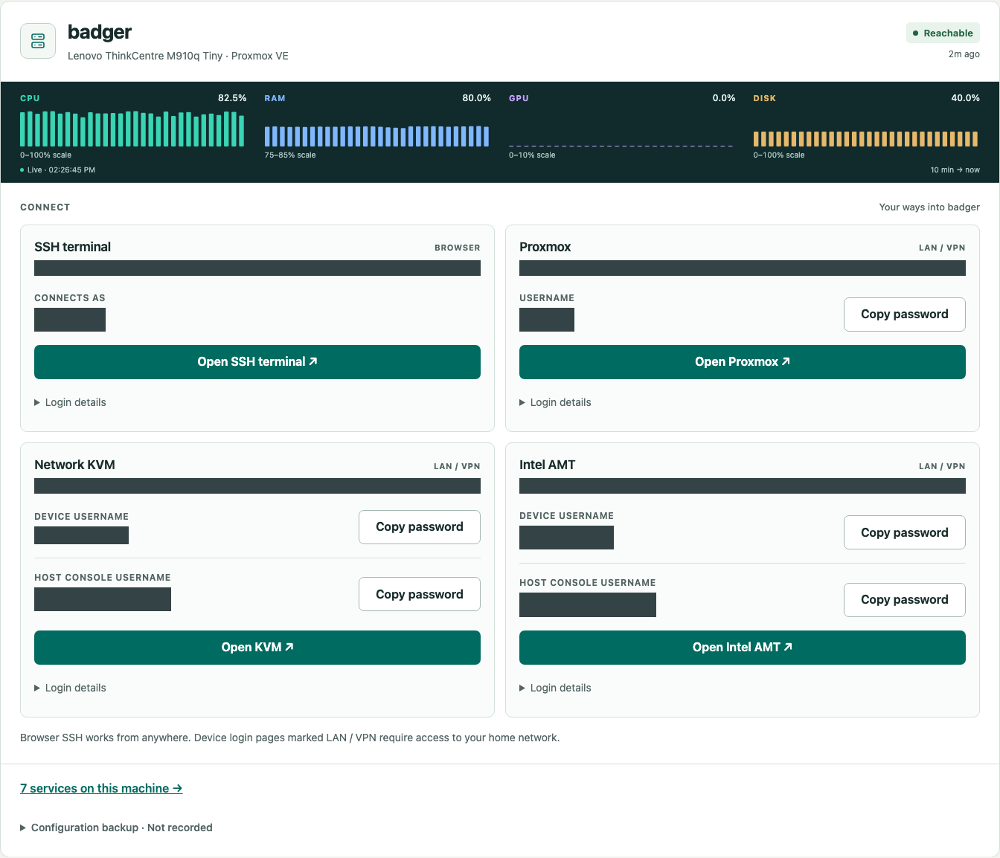
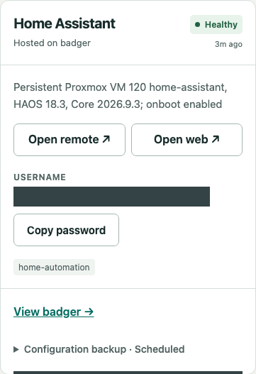
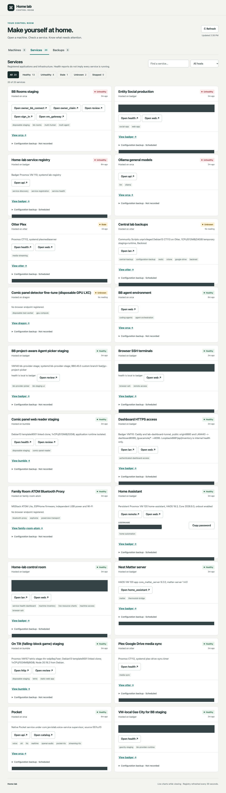

# Home Lab Registry

A small, self-hosted machine and service catalog with an authenticated dashboard. Machines and services have separate views. Machine cards put compact CPU, RAM, GPU and disk history bars above browser SSH, hypervisor, KVM and AMT access. Device and host-console credentials are separate; copy confirmation stays inside the button. Services show health freshness, placement and configuration-backup locations.

## Screenshots

Captured from the running dashboard. Usernames, network addresses and identifying
configuration details are covered with opaque redactions. Health and resource
readings reflect the time of capture.

### Machines

Live resource history and browser-based access on one card.



[View the Machines overview](docs/screenshots/machines-overview.png).

### Services

Service health, endpoints, configuration backups and optional login credentials.



<details>
<summary>View the full Services dashboard</summary>



</details>

## Components

- `registry/`: Python standard-library HTTPS API, SQLite catalog, revisions, health observations, probes and export/restore.
- `dashboard/`: read-only dashboard, cached streaming measurements, credential-copy endpoint, and Apache Guacamole session integration.
- `agent/`: small Go collector using gopsutil, bounded local history and mutually authenticated TLS streams.
- `deploy/metrics/`: collector installation, stream authentication and overhead validation.
- `deploy/guacamole/`: pinned official containers and an example authenticated proxy.
- `skills/home-lab/`: portable copy of the operating skill, including registry discovery, Proxmox/community-script practices and backup procedures. Inventory belongs in the registry, never in the skill.

This repository contains source, examples and the redacted screenshots above. Private catalog exports, network addresses, credentials, private keys, certificates and operational backup archives are not included.

## Deployment

Use a dedicated Linux VM with Python 3.11+, Docker Compose and an authenticated HTTPS reverse proxy. Budget at least 2 GiB RAM for registry, dashboard and Guacamole; actual capacity depends on session count. Install Python dependencies from `requirements.txt`. Run the registry with `python3 registry/registry.py --config /etc/lab-registry/config.json`; inspect `--help` and the config fields at the end of that source. Supply TLS certificate/key, database path and independent reader/writer tokens privately. Bind/route the API only to trusted clients. Run the dashboard using `python3 dashboard/server.py` behind your proxy on loopback 8089. Example service-manager units are in `deploy/`; create their unprivileged accounts and make private files readable only by the appropriate service account.

Dashboard `private/` files (never committed):

| File | Contents |
|---|---|
| `login.json` | `username`, `password` matching the outer dashboard authentication |
| `reader.json` | `url`, `ca_file`, `reader_token`; read access only |
| `registry-ca.pem` | Registry CA, referenced by reader config |
| `origins.json` | JSON array of exact permitted HTTPS origins |
| `stream-ca.pem` | Private metrics CA trust anchor used to verify each agent identity |
| `stream-client.pem`, `stream-client-key.pem` | Dashboard client identity for mutually authenticated agent streams |
| `terminal_key`, `guacamole_known_hosts` | Dedicated interactive SSH key and verified host pins |
| `guacamole-key` | Same signing key as private Guacamole `.env` |
| `machine-passwords.json` | Map of machine or service IDs to login IDs and passwords |

Install and qualify collectors using [the metrics deployment guide](deploy/metrics/README.md). Agent endpoints are discovered from machine records, never a second static host list. The browser never receives agent keys or certificates.

See the Guacamole README for terminal deployment. Preserve Authorization through the reverse proxy to the dashboard; authenticate Guacamole at that same outer boundary. Restrict origins and enable WebSockets. Do not expose the loopback dashboard or Guacamole backend directly.

## Registry records

Use `registry/client.py --help`. Records require name, host, owner, capabilities, endpoints, lifecycle, runbook and dependencies. Machine records include capability `machine`, `resources.kind: machine`, hardware, and `resources.management_access` entries with `id`, `label`, `url`, `username`, and `password_available`. SSH entries use ID `os` and `browser_terminal: /terminal/<host>/`. Optional `resources.console_login` supplies username, credential_id and password_available for host-console login. Service records can also use `resources.management_access` to show a username and Copy password button on their service card. Provision the password in the private mapping under the service record ID and access entry ID; never put it in registry metadata. Secret values belong only in the private mapping. `config_backup` records status, locations and notes. See tests for schema examples.

Writes require writer authentication and `If-Match` revision preconditions. Readers cannot mutate the catalog. Health observations have expiry; unknown/stale is not proof of downtime. HTTP/TCP probes and local exporters are operator-configured; this is not automatic network discovery.

Collectors retain ten minutes of local history even with no viewers. Opening a card
immediately loads that cache, then updates arrive over Server-Sent Events. Each
watched machine has one shared dashboard-to-agent stream, closed after the last
viewer leaves. Hidden tabs stop subscribing. No SSH collection commands or periodic
resource HTTP requests are used. Agent restart resets its bounded RAM history;
dashboard restart does not. Gaps remain gaps. Disk is the most-used monitored
filesystem/storage pool, not throughput. Charts preserve the observed peak in each
20-second display bucket. Agents not yet installed show monitoring unconfigured.

## Security and recovery

Designed for a trusted private lab, not multi-tenant hosting. Dashboard users can open privileged shells and retrieve configured passwords. HTTPS, strong dashboard authentication and tightly scoped network access are required. Passwords never enter rendered page text, but the clipboard, developer tools and recipient application can access copied secrets. Keep backups encrypted and independently recoverable. Site-specific probes belong outside public source.

Take a SQLite-consistent export and back up private configuration, proxy, service units and terminal keys before deployment. Keep a rollback release until actual public login, credential copying, terminal commands and health refresh pass. The included home-lab skill describes centralized encrypted Drive backups; adapt the destination to your environment rather than treating documentation as proof of configured backups.

## Tests

```sh
(cd registry && python3 -m unittest -v)
(cd dashboard && python3 -m unittest -v)
node --check dashboard/app.js
(cd agent && go test -race ./...)
```

Browser qualification should include real clipboard comparison without printing values, real terminal commands, phone-width layouts, live sampling, anonymous/cross-origin rejection and stale/failure states. Desktop emulation does not prove physical mobile keyboard behavior.

### Dashboard inventory categories

`spec.resources.kind` distinguishes `machine`, `virtual-machine`, `container`,
`backup-job`, and `historical-evidence`. Backup jobs appear in **Backups**; guest
and physical machine records appear in **Machines**; archives and retired records
are excluded. Other records appear in **Services**. These are catalog counts,
not counts of running processes.

Set a service's `resources.machine_id` to its actual guest record when hosted in
a VM. Without that relationship the dashboard groups it under its physical host.
`resources.runtime = {"state": "stopped", "checked": <Unix timestamp>}` records
an observed stop. The dashboard labels it **Stopped · recorded**, shows the
observation age, and hides live charts. Legacy `resources.state` values beginning
with `stopped` also display as recorded stops. This is last-known state, not an
inferred live power check; provisioning and monitoring must update the registry
when the environment changes. A healthy service probe does not prove process or
machine runtime state.
