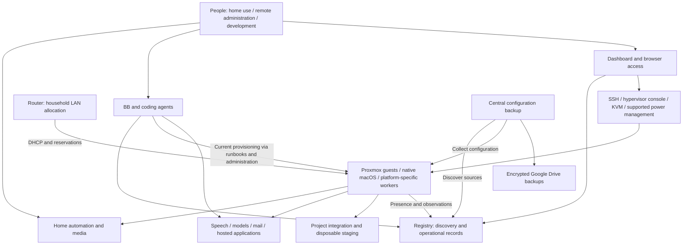

# Current home-lab architecture

As of 2026-10-19. This describes the whole lab's architectural roles and relationships,
using the current registry records and registry/dashboard source at `4663673`.
Reading a deployment record is not a fresh end-to-end health check. Private machine
names, addresses, placements, capacities, credentials and dated operational evidence
remain exclusively in the registry; this document is not a second inventory.

The [vision](../vision/home-lab.md) describes intended outcomes. The
[environment leasing plan](../plans/0001-renewable-test-environments.md) describes
proposed work, not an installed subsystem.

## System boundaries

The lab combines persistent household services, agent orchestration and development
workloads, shared application capabilities, and the infrastructure needed to operate
and recover them. It is a heterogeneous collection of managed hosts and guests,
not one uniform scheduler-controlled compute cluster.

Arrows show relationships, not comprehensive network flows. The router also serves
household devices and management appliances. External service access and third-party
cloud dependencies have their own authentication and availability requirements.

## Compute and workload isolation

Proxmox hosts provide full VMs and Linux containers. Full VMs provide independent
operating systems and the boundary used for service-development staging. Containers
host suitable persistent Linux applications with lower guest overhead and explicit
host-kernel/device dependencies. Neither choice is universal: guest type follows
vendor support, hardware access and the workload's isolation requirements.

The Apple platform supplies native macOS applications and platform-specific testing.
Native service managers and Docker-based deployments coexist with Proxmox workloads;
the entire lab has not been converted to one runtime. Platform tools and registered
templates are the provisioning mechanisms, not evidence that every requested OS,
emulator or hardware-accelerated combination is qualified.

GPU and media acceleration are host-specific capabilities. Guest assignment,
drivers, sharing constraints and workload qualification must be read from current
records. A host GPU metric is not proof that a particular guest can use that GPU.
Personal Windows/gaming use and dual-boot availability are also allocation constraints,
not capacity that an agent may interrupt automatically.

There is no documented unified capacity scheduler or universal shared-storage/HA
layer in this architecture. Local guest disks and physical-host dependencies matter.
A stopped guest can still consume storage. Do not infer migration, failover or
cross-platform portability from the presence of multiple hypervisors.

## Persistent household services

Home Assistant runs as HAOS in a persistent Proxmox VM. Its automation path includes
Matter service integration and a separately powered ESPHome Bluetooth proxy for
supported devices. Those transports are dependencies of device behavior; they are
not interchangeable with the Home Assistant application or a Mac Bluetooth process.

Plex runs as a persistent Linux container service, with a separate scheduled rclone
media-sync function in the same guest. The sync selects the configured Google Drive
media folders for local Plex use. Library metadata, media availability and hardware
transcoding have distinct validation needs. Media synchronization is separate from
the configuration backup system, even though both use Google Drive-related tooling.

Unattended startup is part of these deployments. Routine application operation does
not require a human console login. Their persistent configuration and device/media
relationships must survive migration and maintenance. Protected placement and safe
changes are currently operating procedures, not guarantees of an automated allocator.

## Agent orchestration and project workloads

BB provides persistent coding-agent orchestration; related development/integration
instances are distinct workloads. Its current placement and dependencies belong in
the registry. The architectural intent to use suitable persistent compute is not
proof of a completed orchestration migration.

Agents discover resources through the home-lab skill and registry, then use recorded
SSH or hypervisor access and templates to operate guests. Project services include
persistent integrations, reviewable application deployments and disposable staging.
These are separate from the agent process that requested them. A test VM need not
run the coding agent.

Provisioning, capacity admission, ownership tracking and cleanup are currently
procedural. Existing hypervisor APIs do not provide a lab-wide renewable environment
contract. There is no implemented general lease controller, automatic reconstruction
of matching environments or durable task-evidence API in this repository.

Bazel remote caching and distributed build execution remain vision-level goals
unless independently registered and qualified. They are not established by the
current worker pool or this document.

## Shared application capabilities

The shared speech service exposes speech-related capabilities with Pocket TTS and
voice selection; a named voice is a supported option within the service, not a
separate infrastructure stack. Native platform supervision is part of its recorded
deployment. Model inference is a separate service role, with its own capacity and
hardware requirements; speech and model inference should not be conflated.

Agent email uses a persistent mail server with protocol endpoints and a separate
webmail interface. Hosted applications and shared integrations have their own
service records and deployment lifecycles. Registry dependencies describe how to
find these services; credentials and caller authorization remain separate.

Tests may call authorized shared services through supported interfaces. That does
not authorize replacing a stable implementation with candidate code. Work requiring
a modified dependency follows the disposable-development isolation rules.

## Networking, identity and access

The household eero router is the IPv4 allocation authority. DHCP is preferred;
static LAN assignments require matching router reservations for the interface's own
MAC. Isolated guest/NAT networks, container networks, VPNs and loopback are different
address scopes. Their existence does not authorize claiming another household lease.

Enrolled metrics agents also report address presence, independently of logged-in
users. Registry bindings update selected service, monitoring and access endpoints
while SSH keys and TLS identities remain tied to machine identity. This is explicit
enrollment and binding, not automatic discovery of every device or allocation of IPs.

Human access combines the authenticated public dashboard, browser SSH through
Guacamole, and supported hypervisor, KVM and AMT interfaces. Some appliance paths
require LAN/VPN reachability. Network KVMs are independent devices with their own
credentials, addresses and certificates; reaching one does not establish working
video, host login or host power control. Recovery capability is verified per machine.

Public access uses authenticated HTTPS proxy/tunnel routes where configured. Not
all service endpoints are public. Private client configuration and protected secret
stores supply bootstrap and credentials. The current operator dashboard has powerful
access; it is not the scoped authority boundary proposed for ordinary test agents.

## Discovery, observability and administration

The registry holds machine and service identities, relationships, capabilities,
runbooks, access references, backup coverage and dated observations. Skills carry
reusable procedures. Public source carries implementations and examples. The
registry is authoritative operational information, not proof that an observation
is still fresh or a desired configuration has been applied.

The dashboard separates machines, services and backups, provides browser access,
and displays low-overhead CPU/RAM/GPU/disk history. Collectors retain bounded local
history and stream while viewed. Health checks, runtime reads and address presence
are separate from resource streaming; some run independently of viewers. Cached
metrics history is not a durable experiment archive.

A user-triggered IP audit compares router authority with actual configuration and
reports violations separately from unverified coverage. It is read-only detection,
not preventive admission control. Routine monitoring is deterministic code, not
scheduled agent inference. Warnings and incomplete verification remain visible work.

The [registry/dashboard architecture](registry-dashboard.md) documents the HTTPS
API, SQLite state, collectors, authentication, update cadence and source modules.

## Configuration backup and recovery

One central Backrest controller orchestrates configuration exports using registry
source resolution and constrained, pinned SSH access. Restic and rclone provide
versioned encrypted storage in Google Drive, the sole retained backup destination.
Temporary export staging and working caches are not independent backup systems.
Private deployment manifests determine actual coverage; a listed service is not
necessarily proven recoverable.

Configuration backup, media synchronization, source control and task artifacts serve
different purposes. Git preserves public source; it does not replace private
configuration recovery. Media files are not implied to be in configuration archives.
Future task-evidence retention must integrate with the approved durable destination
without treating existing configuration backups as a complete evidence service.

Registry recovery requires exported catalog data and private bootstrap/access
material retrievable without the failed registry host. Recovering a service also
requires its runtime dependencies and a viable destination. Archive validation,
application restoration and whole-lab recovery are different levels of evidence.
There is no implied automatic host failover or zero-data-loss disaster recovery.

## Change, failure and verification boundaries

Service source development runs in an isolated disposable VM. Stable promotion
requires approval for the candidate, production verification and preservation of
recoverable rollback artifacts. Dedicated staging is then deleted and records retired.
Third-party installations and migrations follow their authorized backup/cutover
procedures rather than automatically acquiring a service-development staging gate.

Host failure can remove all guests and local state on that host. Registry or access
service failure can impair discovery and administration even while household services
continue. Router, public access and backup-provider failures affect different paths.
Independent console access and recovery material reduce those dependencies; they do
not remove the need to exercise recovery.

This review read catalog deployment descriptions and implementation source, not
all live application flows. Current status, restore results, hardware readiness and
remaining exceptions must be checked in the registry and verified before operations.
When a plan is implemented, update the affected architecture boundaries with actual
behavior and validation; keep proposed capabilities in plans until then.
