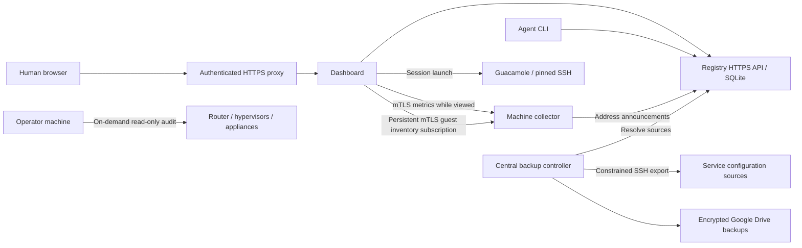

# Registry and dashboard architecture

Reconciled 2026-11-22 against `main` at `63624fb` and the verified production
inventory and backup rollouts. The lease integration below is verified in the
disposable review build at `e86592f`. Current deployment identities and
operational evidence belong in the registry.

This is the implementation detail for the [whole-lab architecture](current.md).

## Components and data flow

### Catalog and discovery

[`registry/rust/src/service.rs`](../../registry/rust/src/service.rs) serves a Rust
HTTPS API backed by SQLite. Service and machine documents share `/v1/services`;
capabilities and resource metadata distinguish types. Separate tables store revision
history, health observations and address presence. Writes require a writer token
and revision preconditions. A reader token permits discovery; enrolled machines
have separate scoped presence authentication. Catalog exports support recovery.

[`registry/rust/src/client.rs`](../../registry/rust/src/client.rs) supplies the CLI and authenticated
curl transport. It verifies TLS, rejects redirects, retries selected read failures,
and rejects incomplete responses. Ambiguous writes are not automatically replayed.
Private client configuration bootstraps discovery without consulting the dashboard.

The schema has a loosely structured `resources` object, whole-document updates,
a 65,536-byte request limit, and generic writer attribution in revision history.
Allocation transactions belong to the separate staging controller.

### Address identity and presence

[`agent/registration.go`](../../agent/registration.go) runs independently of user
login and dashboard viewers. It checks the configured interface and announces an
address change or periodically refreshes presence. This reports addresses; it does
not allocate them or prove a router reservation exists.

[`registry/rust/src/enrollment.rs`](../../registry/rust/src/enrollment.rs) authenticates enrollments,
restricts allowed networks, supports collector-identity verification, and overlays
fresh or explicitly stale presence onto selected endpoints. Service bindings and
[`registry/rust/src/client.rs`](../../registry/rust/src/client.rs) let consumers resolve changing
addresses while preserving stable machine identity and pinned SSH host keys.

### Dashboard, access and observations

[`dashboard/rust/src/lib.rs`](../../dashboard/rust/src/lib.rs) serves the UI and authenticated
APIs behind a reverse proxy. It reads the catalog at startup and on **Reconcile now**,
and streams current inventory results to the browser over SSE. The registry
metadata change feed has a separate [review candidate](https://github.com/csells/home-lab-registry/tree/82dc0fa).
Staging observed an isolated catalog retirement update an open browser.
Production still reads metadata on startup and manual reconciliation.
[`dashboard/rust/src/inventory.rs`](../../dashboard/rust/src/inventory.rs) separates machines, services,
backup jobs and historical records. Catalog counts are not process counts.

The read-only Resources (`#map`) tab uses the same inventory and filters as the
Machines, Services and Backups tabs. Machine items retain `kind: machine` and add
`machine_type` (`machine`, `virtual-machine`, or `container`) and `machine_id`;
items also expose declared dependency IDs as `dependencies`. Physical machines have
a null parent. Guests use explicit `resources.machine_id`; hostname coincidence never
places a guest. No new registry schema, collector or discovery source is introduced.

[`resource-graph.ts`](../../dashboard/frontend/resource-graph.ts) builds a compound graph and
lays it out with ELK.js 0.12.1 Layered in a Web Worker, rendering
ELK's orthogonal edge sections. Stable input and a fixed seed make layout repeatable;
cached geometry avoids relayout on status-only refreshes. The graph renders at actual
size with no internal pan, zoom or click actions. Filters keep ancestors for context;
missing parents and cycles appear under Unplaced. Relationships are declarations,
not monitored traffic. The static-route allowlist adds only the named graph assets
and worker. The npm build supplies the worker from the pinned dependency. The [research decision](../research/graph-layout.md)
records alternatives, license and version pin.

Validation: `dashboard/frontend/tests/resource-graph.test.ts` covers hierarchy, ancestor/cyclic edges,
stable ordering, filtering and orthogonal routes; `dashboard/rust/tests/http_contract.rs` covers
placement metadata; `dashboard/frontend/tests/browser/resources.test.ts` renders the tab through the real
static routes/CSP at desktop and phone widths.

Protected credential-copy controls and Guacamole session launch use private
configuration outside source control. Host-console credentials are distinct from
KVM credentials. This is a trusted operator interface with privileged access, not
a multi-tenant or task-scoped provisioning boundary.

The Go collector in [`agent/`](../../agent/) samples resource usage into bounded
local memory, normally ten minutes of history. It continues sampling without
viewers. [`dashboard/rust/src/collector.rs`](../../dashboard/rust/src/collector.rs) shares one upstream
mTLS stream per watched machine and fans it out through browser SSE. Hidden tabs
unsubscribe. Collector restart loses its RAM history; gaps are not fabricated.
The stream is not a durable task-evidence archive. Collection overhead has specific
qualification evidence in [`deploy/metrics/`](../../deploy/metrics/), not a universal
zero-overhead guarantee.

Health observations expire independently of resource metrics. Each machine's
collector reads its own hypervisor inventory (Proxmox API with a read-only token,
or `tart list`) and serves it on the same mutually authenticated listener.
[`dashboard/rust/src/guests.rs`](../../dashboard/rust/src/guests.rs) subscribes
through `InventorySubscriptions` to one inventory stream per configured collector.
Each stream sends a cached first report, change events and freshness heartbeats.
Local hypervisor sampling continues. The dashboard expires state with the report,
at most fifteen minutes after observation. Browser terminals use separate
credentials. Runtime, reachability, application function and available capacity
are different facts.

[`dashboard/rust/src/reconcile.rs`](../../dashboard/rust/src/reconcile.rs) joins fresh
reports and explicit host/guest bindings, including the legacy structured IDs.
It reports guest mismatches, records for review and incomplete coverage separately.
An unverified collector produces a coverage warning. Missing-guest findings
require a fresh complete report. **Reconcile now** reloads catalog metadata and
reconnects to each collector's current report. The accepted comparison ID ties the
browser result to that request on both the stream and the status endpoint.
The Discrepancies tab combines deployment discrepancies, current machine, service
and backup failures, published IP reservation audit violations, and current
lease problems. Warnings and expired or inconclusive checks have separate counts.
Catalog and collector freshness are independent. The dashboard labels disconnected
catalog feeds and any isolated preview catalog snapshot. In the registry change
stream, health-only events name affected records for a bounded health read.
Endpoint and deployment changes update the full catalog. Lease ownership is
rechecked on a guest change, a manual comparison or recovery from a failed join.
While a dashboard is viewed, one shared read of the allocator's issue summary
runs per dashboard instance at most once every twenty seconds during ordinary
viewing, and also when the next known lease becomes overdue or on explicit refresh.
The current summary reaches browsers through the dashboard stream.
Machine cards show the hardware facts. Authenticated API consumers can retrieve
the complete observed inventory.

[`TestGuestStreamInitialChangeAndQuiet`](../../agent/guest_stream_test.go),
[`Inventory stream tests`](../../dashboard/rust/tests/http_contract.rs) and
[`Reconciliation tests`](../../dashboard/rust/src/reconcile.rs) cover stream
delivery, freshness and discrepancy semantics. The production rollout verified
all six configured streams, authenticated mobile rendering and manual comparison.
Registry metadata changes, native events and presence outside guest inventory
remain in [plan 0005](../plans/0005-inventory-coverage-and-change-delivery.md).
[Delivery record](../plans/archive/0003-inventory-reconciliation.md)

The IP audit is an on-demand, read-only operation run from an operator machine,
implemented in [`lab-network-audit`](../../dashboard/rust/src/network/mod.rs) and its
collectors. The Discrepancies tab uses the latest result published to the registry. The audit compares
router authority with host/guest/appliance configuration and distinguishes violations
from incomplete verification. It detects problems; it is not an admission controller.

### Configuration backup and recovery

[`backup/rust/src/bin/lab-backup-collect.rs`](../../backup/rust/src/bin/lab-backup-collect.rs) is an export hook for the central
Backrest controller. It resolves sources through the registry, uses pinned SSH,
and checks exported archives in temporary staging. For supported guest sources,
[`backup/rust/src/lib.rs`](../../backup/rust/src/lib.rs) checks the binding against a fresh
observation before choosing the address. The forced read-only command in
[`backup/rust/src/bin/lab-backup-proxmox-observe.rs`](../../backup/rust/src/bin/lab-backup-proxmox-observe.rs) accepts only enrolled
guests. Portable archive validation preserves the native restore bytes.

Backrest, restic and rclone handle scheduling, versioning, encryption and Google
Drive storage. Deployment profiles and credentials are private.
[`backup/rust/tests/capture.rs`](../../backup/rust/tests/capture.rs) covers identity
and access rejection, and [`backup/rust/tests/capture.rs`](../../backup/rust/tests/capture.rs)
covers portable acceptance and corrupt archives. The production deployment record
holds source hashes and restore evidence. Application recoverability is assessed
through the restore checks recorded for each service. [Merged collector delivery](https://github.com/csells/home-lab-registry/pull/1)

Independent recovery requires both a catalog export and private bootstrap/access
configuration. The recovery bundle must be retrievable without the failed registry
host. This document specifies the dependency; it does not certify every backup.

## Environment operations today

Stable agents use the home-lab skill, registry runbooks and authenticated
hypervisor access to provision and retire guests. The staging controller exercises
renewable leases, scoped access, checkpoint-gated reclamation and matching
replacement as described in [the whole-lab staging architecture](current.md#allocator-staging).

The candidate dashboard uses a dedicated read-only review credential to read
lease summaries and an active clone projection. It joins that projection on
changed guest observations or manual comparison. Unchanged heartbeats use the
cached join. An unavailable allocator yields an unverified ownership entry.
Provider mutation, task access and evidence retrieval stay under the controller's
separate authorization checks. The live staging browser verified the managed
lease link and row removal after release. [Dashboard join](https://github.com/csells/home-lab-registry/blob/e86592f9c6af06db2f84d08397aee4bdf8f85618/dashboard/lease_review.py) · [Lease projection](https://github.com/csells/home-lab-registry/blob/e86592f9c6af06db2f84d08397aee4bdf8f85618/allocator/review.py)

Persistent services and disposable development have different lifecycles. Service
source changes require an isolated staging VM and explicit promotion approval;
promotion includes verified cleanup of dedicated staging resources. Existing
third-party installation/migration follows its authorized backup and cutover plan.

## Change discipline

Keep the [vision](../vision/home-lab.md) stable around outcomes. Keep unimplemented
designs in numbered plans. When behavior is implemented and verified, update the
affected boundaries here, link validation, and retain unresolved work in the plan.
Do not copy private inventory into these documents.
