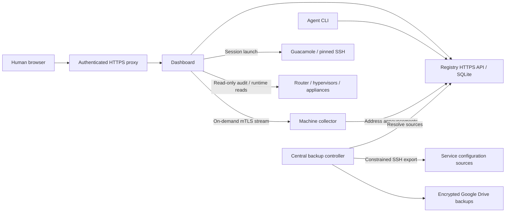

# Registry and dashboard architecture

Source baseline: `4663673`, inspected 2026-10-19. This describes implemented code
and operating boundaries, not a fresh fleet-health audit. Actual deployments,
addresses, versions, owners and recovery evidence belong in the private registry.
The [leasing plan](../plans/0001-renewable-test-environments.md) is not implemented.
Update this document with verified behavior when that plan is implemented.

This is the implementation detail for the [whole-lab architecture](current.md).

## Components and data flow

### Catalog and discovery

[`registry/registry.py`](../../registry/registry.py) serves a Python standard-library
HTTPS API backed by SQLite. Service and machine documents share `/v1/services`;
capabilities and resource metadata distinguish types. Separate tables store revision
history, health observations and address presence. Writes require a writer token
and revision preconditions. A reader token permits discovery; enrolled machines
have separate scoped presence authentication. Catalog exports support recovery.

[`registry/client.py`](../../registry/client.py) supplies the CLI and authenticated
curl transport. It verifies TLS, rejects redirects, retries selected read failures,
and rejects incomplete responses. Ambiguous writes are not automatically replayed.
Private client configuration bootstraps discovery without consulting the dashboard.

The schema has a loosely structured `resources` object, whole-document updates,
a 65,536-byte request limit, and generic writer attribution in revision history.
These are current limitations; it has no typed transactional lease API.

### Address identity and presence

[`agent/registration.go`](../../agent/registration.go) runs independently of user
login and dashboard viewers. It checks the configured interface and announces an
address change or periodically refreshes presence. This reports addresses; it does
not allocate them or prove a router reservation exists.

[`registry/presence.py`](../../registry/presence.py) authenticates enrollments,
restricts allowed networks, supports collector-identity verification, and overlays
fresh or explicitly stale presence onto selected endpoints. Service bindings and
[`registry/resolve.py`](../../registry/resolve.py) let consumers resolve changing
addresses while preserving stable machine identity and pinned SSH host keys.

### Dashboard, access and observations

[`dashboard/server.py`](../../dashboard/server.py) serves the UI and authenticated
APIs behind a reverse proxy. It refreshes registry-derived inventory every 30 seconds.
[`dashboard/model.py`](../../dashboard/model.py) separates machines, services,
backup jobs and historical records. Catalog counts are not process counts.

Protected credential-copy controls and Guacamole session launch use private
configuration outside source control. Host-console credentials are distinct from
KVM credentials. This is a trusted operator interface with privileged access, not
a multi-tenant or task-scoped provisioning boundary.

The Go collector in [`agent/`](../../agent/) samples resource usage into bounded
local memory, normally ten minutes of history. It continues sampling without
viewers. [`dashboard/metrics.py`](../../dashboard/metrics.py) shares one upstream
mTLS stream per watched machine and fans it out through browser SSE. Hidden tabs
unsubscribe. Collector restart loses its RAM history; gaps are not fabricated.
The stream is not a durable task-evidence archive. Collection overhead has specific
qualification evidence in [`deploy/metrics/`](../../deploy/metrics/), not a universal
zero-overhead guarantee.

Health observations expire independently of resource metrics. The dashboard's
[`machine_runtime.py`](../../dashboard/machine_runtime.py) performs bounded,
deterministic hypervisor reads at ten-minute intervals with fifteen-minute freshness.
Runtime, reachability, application function and available capacity are different facts.

The IP audit is an authenticated, on-demand, read-only operation implemented in
[`network_audit.py`](../../dashboard/network_audit.py) and its collectors. It compares
router authority with host/guest/appliance configuration and distinguishes violations
from incomplete verification. It detects problems; it is not an admission controller.

### Configuration backup and recovery

[`backup/collect.py`](../../backup/collect.py) is an export hook for the central
Backrest controller. It resolves sources through the registry, uses pinned SSH,
checks exported archives and stages them temporarily. Backrest/restic/rclone handle
scheduling, versioning, encryption and Google Drive storage. Private manifests and
credentials remain outside Git. Archive checks do not establish application restore
success; live restore evidence belongs in registry records.

Independent recovery requires both a catalog export and private bootstrap/access
configuration. The recovery bundle must be retrievable without the failed registry
host. This document specifies the dependency; it does not certify every backup.

## Environment operations today

Agents use the home-lab skill, registry runbooks, existing hypervisor APIs and
authenticated access to provision and retire guests. Ownership, capacity checks,
expiry and cleanup are procedural. The source contains no general environment
allocator, enforced renewable leases, durable test-evidence service or automatic
matching-environment reconstruction. A hypervisor API is not those capabilities.

Persistent services and disposable development have different lifecycles. Service
source changes require an isolated staging VM and explicit promotion approval;
promotion includes verified cleanup of dedicated staging resources. Existing
third-party installation/migration follows its authorized backup and cutover plan.

## Change discipline

Keep the [vision](../vision/home-lab.md) stable around outcomes. Keep unimplemented
designs in numbered plans. When behavior is implemented and verified, update the
affected boundaries here, link validation, and retain unresolved work in the plan.
Do not copy private inventory into these documents.
